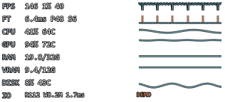
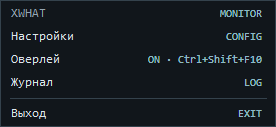
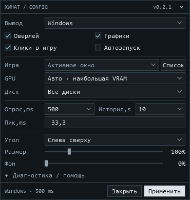

# X What

Компактный монитор для игр на Windows x64: .NET 10, WPF, LibreHardwareMonitor 0.9.6, PresentMon 2.6.0.



На превью — искусственные данные деморежима.

## Запуск

1. Скачайте ZIP на [странице релиза v0.2.1](https://github.com/glitchykid/xwhat/releases/tag/v0.2.1), распакуйте его целиком в постоянную папку и запустите `XWhat.exe`. Устанавливать .NET для этого архива не нужно.
2. Для **эксклюзивного полного экрана** установите [RTSS с официальной страницы Guru3D](https://www.guru3d.com/download/rtss-rivatuner-statistics-server-download/) и запустите его. В RTSS включите OSD и настройте размер, положение и тёмную обводку текста; оставьте фон прозрачным. Поддерживается формат общей памяти RTSS 2.14 и новее.
3. По умолчанию включён вывод **Авто**: полноэкранное окно с доступным RTSS использует RTSS, остальные окна — оверлей Windows. Укажите процесс игры, например `Cyberpunk2077.exe`, или оставьте поле пустым для активного окна. Выбрать уже запущенную игру можно кнопкой «Список». Оба способа вывода можно выбрать вручную.
4. В оверлее только данные: числа слева, графики справа. Фон прозрачный, без заголовка и рамки; размер по умолчанию **316 × 144** логических пикселя. Масштаб 75% уменьшает окно до 237 × 108. Тёмная обводка чисел и линий сохраняет контраст на светлых сценах. Окно автоматически располагается в выбранном углу монитора активной игры с учётом DPI. Для выравнивания колонок RTSS используйте моноширинный шрифт, например Consolas; его положение и размер задаются в RTSS.
5. Настройки открываются двойным кликом или правой кнопкой на значке в трее. `Ctrl + Shift + F10` показывает/скрывает оверлей. Чтобы двигать окно мышью, отключите пропуск кликов.
6. Для автозапуска включите **«Автозапуск»** и нажмите «Применить». Он регистрируется только для текущего пользователя и запускает приложение в фоне без окна настроек и запроса UAC. Выключение галочки удаляет регистрацию. Если переместили приложение или распаковали обновление в другую папку, снова примените настройки, чтобы обновить путь.

Обновление старых настроек v0.1.0 автоматически выбирает «Авто» и прозрачный фон, сохраняя выбор устройств, угол, масштаб и интервал опроса. Последующие изменения сохраняются как ваши настройки.

**Без RTSS прозрачное окно не гарантируется поверх эксклюзивного полного экрана.** Доступность RTSS в конкретной игре зависит от графического API и политики игры в отношении оверлеев. Приложение не обходит ограничения игры.

Распознавание использует границы активного окна относительно монитора и Windows `QUNS_RUNNING_D3D_FULL_SCREEN` для эксклюзивного Direct3D. Геометрия окна сама по себе не отличает borderless от exclusive для всех API. При отсутствии RTSS «Авто» использует окно Windows, а в настройках сообщает, что для эксклюзивного режима нужен RTSS.

## Настройки из трея





Панель занимает **370 × 390** логических пикселей. Настройки помещаются в плотные строки; подробности датчиков и ссылки на RTSS/PawnIO открываются в разделе «Диагностика / помощь». Меню показывает состояние оверлея `ON` / `OFF`. Угол, размер и фон относятся к выводу Windows; оформление RTSS настраивается в RTSS.

## Что отображается

| Показатель | Источник и смысл |
|---|---|
| CPU | Общая загрузка Windows, температура package/Tctl либо максимальная температура доступных ядер |
| GPU | Загрузка 3D/core и температура выбранной видеокарты |
| RAM | Физическая использованная/общая память, график загрузки; температура при наличии датчика |
| VRAM | Выделенная видеопамять выбранной GPU, график загрузки; температура памяти при наличии датчика |
| Диск | Активность, чтение/запись MiB/s, температура; в режиме «Все диски» средняя I/O latency и максимальная температура дисков |
| FPS / frame time | Каждый интервал Present выбранного процесса и основной swap chain, полученный PresentMon через ETW |
| 1% low | 1000 / среднее время самых медленных 1% кадров в выбранном окне истории |
| Пики | Кадры дольше заданного порога **и** двух медианных длительностей в окне истории |

История 5–60 секунд. График времени кадров сохраняет минимумы и максимумы внутри каждого столбца, поэтому короткие пики не теряются при уменьшении графика. Графики нагрузки позволяют сопоставлять пики с CPU, GPU, памятью и диском; совпадение не доказывает причину статтера. FPS относится к Present-вызовам приложения, а не к измерению физически показанных кадров или кадров, сгенерированных драйвером.

`—` означает недоступное значение. Объём памяти показан в **GiB**, скорость диска — **MiB/s**. Для выбранного отдельного диска задержка отображается `—`: системный PDH-счётчик задержки агрегируется по всем дискам.

Сокращения технического HUD: `FT` — время кадра в ms; `P` — максимум за историю; `S` — число пиков; `G` — GiB; `C` — °C; `IO` — чтение `R` и запись `W` в MiB/s (`M`), затем средняя задержка в ms. Справа от FPS показан график мгновенного FPS, справа от FT — график времени кадров.

## Температуры и права

Для части температур CPU LibreHardwareMonitor 0.9.6 требует [подписанный драйвер PawnIO](https://pawnio.eu/) и права администратора. Установка драйвера выполняется отдельно. Приложение не требует повышения прав при каждом запуске; CPU/RAM и доступные GPU-датчики работают с обычными правами. Если температура недоступна, проверьте поддержку оборудования и при необходимости запустите X What от администратора.

PresentMon требует права ETW: обычно запуск от администратора либо членство в группе **Performance Log Users** («Пользователи журналов производительности»). [Официальные требования PresentMon](https://github.com/GameTechDev/PresentMon/blob/v2.6.0/README.md#user-access-denied). Запускайте RTSS и X What с одинаковым уровнем прав, если нет доступа к общей памяти.

Автозапуск не повышает права. Чтобы FPS работал при обычном входе в Windows, настройте доступ ETW через Performance Log Users. Windows может задержать запуск или отключить его через раздел «Автозагрузка» Диспетчера задач.

Настройки и ограниченный по размеру диагностический журнал: `%LOCALAPPDATA%\XWhat`. Папку можно открыть через трей. Неизвестные датчики не заменяются нулями; отсутствие кадров более двух секунд очищает FPS. «ДЕМО» использует искусственные данные, запускается через `XWhat.exe --demo`.

## Сборка из исходников

Нужны Windows x64, PowerShell 7 и [.NET SDK 10.0.401](https://dotnet.microsoft.com/download/dotnet/10.0) или его более новый стабильный patch в той же ветке.

```powershell
pwsh -File scripts/Build.ps1
pwsh -File scripts/Release.ps1
```

`Build.ps1` проверяет SHA-256 официального PresentMon, восстанавливает фиксированные NuGet-зависимости, запускает xUnit v3 и собирает приложение. `Release.ps1` создаёт автономный portable ZIP, SHA-256 и список зависимостей в `artifacts/release`. Для превью интерфейса: `pwsh -File scripts/Preview.ps1`.

GitHub Actions проверяет сборку и при теге `v*` **публикует** релиз с portable ZIP и SHA-256. Версии `0.x` помечаются как предварительные, но доступны для скачивания. Перед стабильным выпуском выполните ручную проверку в игре из [docs/verification.md](docs/verification.md). Архитектура и контракты: [docs/architecture.md](docs/architecture.md).
